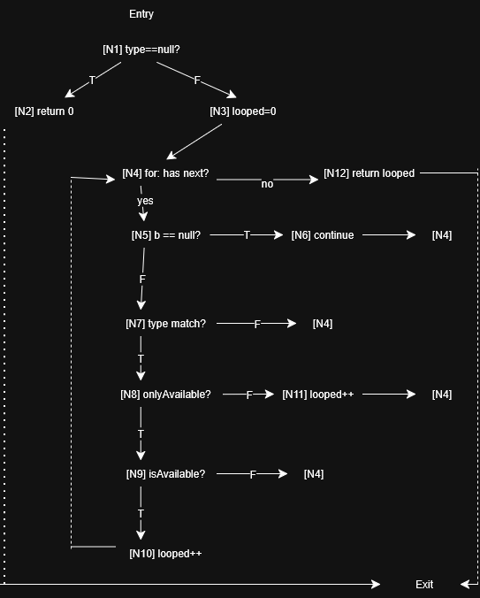

# Assignment 3 White-Box Testing Report

**Student name:** Jason Elliott
**ASU ID:** Jaelli15
**Whitebox branch:** `Whitebox`  
**Commit represented by this report:** [commit hash]

## AI-use statement

Choose one and complete it:

- [X] I did not use generative AI for this report or implementation.
- [ ] I used generative AI only for permitted grammar/table-formatting help. Tool and exact use: [describe].

The CFG, test design, tests, implementation, coverage interpretation, and reflection are my own work.

## 1. checkoutBook implementation evidence

| Evidence | Commit hash/link or result |
|---|---|
| Commit that configures my Assignment 2 tests to run against `Checkout.class` | [Commit](https://github.com/Jaelli15/SER316-Assignment2/commit/900bee3d4f1cd900127a87257112ada3c9f3df6a) |
| Initial `./gradlew blackBoxTest` result before implementation | BUILD FAILED: 2 actionable tasks: 2 executed; EX: "error: cannot find symbol Checkout0.class"  |
| Commit containing my `checkoutBook()` implementation | [Commit](https://github.com/Jaelli15/SER316-Assignment2/commit/2d33ddcc2d2f0b54d59e32293699905b10941860) |
| Final `blackBoxTest` result | CheckoutBlackBoxSample > T2: Unavailable book returns error code 2.0 > [1] class Checkout PASSED; CheckoutBlackBoxSample > T1: Successful checkout - available book, eligible patron > [1] class Checkout PASSED |
| Final `whiteBoxTest` result | CheckoutWhiteBoxSample > WB Test: countBooksByType - null type branch PASSED |

## 2. Control-flow graph for countBooksByType

Embed your CFG image below. The graph must show entry/exit, executable statement groups, decision outcomes, loop entry/back/exit behavior, and the early return. Use current source line numbers or short statement labels consistently.

### Node legend

| Node | Source line(s) or statement | Role in control flow |
|---|---|---|
| N1 | if(type == null) | splits the early end path from main |
| N2 | return 0; | early exit before loop |
| N3 | int looped = 0; | initialization of looped |
| N4 | for (Book b : bookList.values()) | main decision loop |
| N5 | if (b == null) | decision inside of loop, filters out null |
| N6 | continue; | skips rest of the iteration |
| N7 | if (b.getType() == type) | Separates matching books from non matching ones; Non-matching books skip counting |
| N8 | if (onlyAvailable) | Chooses between filtered counting and count-all |
| N9 | if (b.isAvailable) | Counts only if copies remain else skips to end |
| N10 | looped++ for available branch | Counts matching available book then returns loop header |
| N11 | looped++ for else branch | Counts matching book despite availability then returns loop header |
| N12 | return looped; | After iteration is over, return looped |

## 3. Coverage-to-test design

Add as many rows as your design requires; there is no fixed minimum. Collectively, the rows must cover every CFG node and edge. Inputs must be concrete enough that another person could implement the test without guessing.

| Case | Targeted node/edge sequence or decision outcome | Concrete inventory setup and method inputs | Expected return | JUnit test method | Why this case is necessary |
|---|---|---|---:|---|---|
| WB1 | Entry->N1->N2->Exit | Empty Checkout; c.countBooksByType(null, true) | 0 | testCountBooksByType_nullType_returnsZero() | Only case that takes the early exit and covers N2 |
| WB2 | Entry->N1->N3->N4->N12->Exit | Empty Checkout; c.countBooksByType(BookBookType.FICTION, true) | 0 | testCountBooksByType_emptyInv_returnsZero() | Only case where the loop exits on first test. Covers N12 |
| WB3 | N4->N5->N6->N4; N5->N7->N4; N7->N8->N9->N10->N4; N9->N4; N4->N12 | c.countBooksByTYpe(Book.BookType.FICTION, true) | 1 | testCountBooksByType_onlyAvail_mixedInv_countsAvailMatches() | Covers the null skip, the type mismatch, and outcomes of isAvailable() |
| WB4 | N7->N8->N11->N4 | c.countBooksByType(Book.BOokType.FICTION, false) | 2 | testCountBooksByType_allBooks_mixedInv_countsAll() | Only case that takes the count-all branch. Covers N11 |

### Coverage argument

Identify where your table covers each decision's true and false outcomes and the loop's zero-iteration, iteration/back-edge, and exit behavior. If one test covers several items, name that test rather than repeating its setup.

[Your response]

## 4. JaCoCo results

Command used: `./gradlew clean test jacocoTestReport`

Record the final values from `build/reports/jacoco/test/html/index.html`.

| Scope | Line coverage | Branch coverage | What this scope tells you |
|---|---:|---:|---|
| Whole project | 38% | 25% | Shows how much of the codebase the test works with. Current tests do not cover Patron, Book, or Checkout so its low |
| `Checkout` class | 42% | 29% | Shows how much of Checkout was run |
| `Checkout.countBooksByType()` | 100% | 100% | Shows if test covers all nodes, edges, and decisions |

**Does `countBooksByType()` have complete branch coverage?** Yes

If no, identify the exact uncovered decision outcome and specify the additional setup, input, and expected result needed to cover it. If yes, identify the test methods responsible for the last decision outcome you covered.

The last test of onlyAvailable == false was performed last because it is the only outcome that needs onlyAvailable = flase with a matching book. testCountBooksByType_allBooks_mixedInv_countsAll() uses mixed inventory and calls countBooksByType(Fiction, false). 

## 5. Evidence-based analysis and reflection

### Structural insight

Name one test that you designed because you inspected the implementation structure rather than only the JavaDoc. Identify the relevant node/edge and explain why black-box analysis alone might not have suggested it.

testCountBooksByType_onlyAvail_mixedInv_countsAvailMatches(); The JavaDoc does not mention null books in the inventory and the "if (b == null)" test needed to be reached by using a null value in the inventory map. That test then is able to cover N5 and N6 resulting in all branches being covered 100%. 

### Interpreting coverage

What does your JaCoCo evidence support about your tests? What can it **not** establish about correctness? Refer to at least one percentage and one named test or uncovered condition.

JaCoCo's 100% line and branch coverage shows that the tests execute every node and outcomes of all six decisions while the small percentage of project wide line/branch coverage shows that the white-box testing only deals with a small portion of the code. It only tests that the code runs as intended not that the results are correct in normal usage. Also, it only tests a small portion of the code not the whole project.

### Black-box compared with white-box testing

Give one concrete contribution from each approach in this assignment. Which combination gave you more confidence in `Checkout`, and why?

Using both black-box testing and white-box testing gave the most confidence because it tests different things. The black-box test shows that the code does what the specifications say while the white-box testing with JaCoCo shows that every path was actually checked. Both of these alone will give good results and some confidence in the condition of the program but it takes running both to fully show how well its works. 

### Remaining risk

Identify one realistic defect or interaction that your current tests might still miss. Explain why it remains outside or weakly represented in your test suite.

The defect mentioned earlier about availability possibly being incorrect due to different calls to different versions of availability. Only way to truly test against that is to set up a reference book type test so see if the availability changes based on trying to return a reference book compared to a normal book. This small chance of availability discrepency is hard to test for in current tests.

## 6. Final submission check

- [x] The report identifies the exact graded commit.
- [x] The CFG image renders on GitHub.
- [x] Every designed case maps to an implemented JUnit method.
- [x] Student black-box, white-box, and complete test tasks run.
- [x] JaCoCo values are copied from the final report.
- [x] All placeholders and instructional rows have been removed.
- [x] The completed file, CFG image, implementation, and tests are pushed on `Whitebox`.
